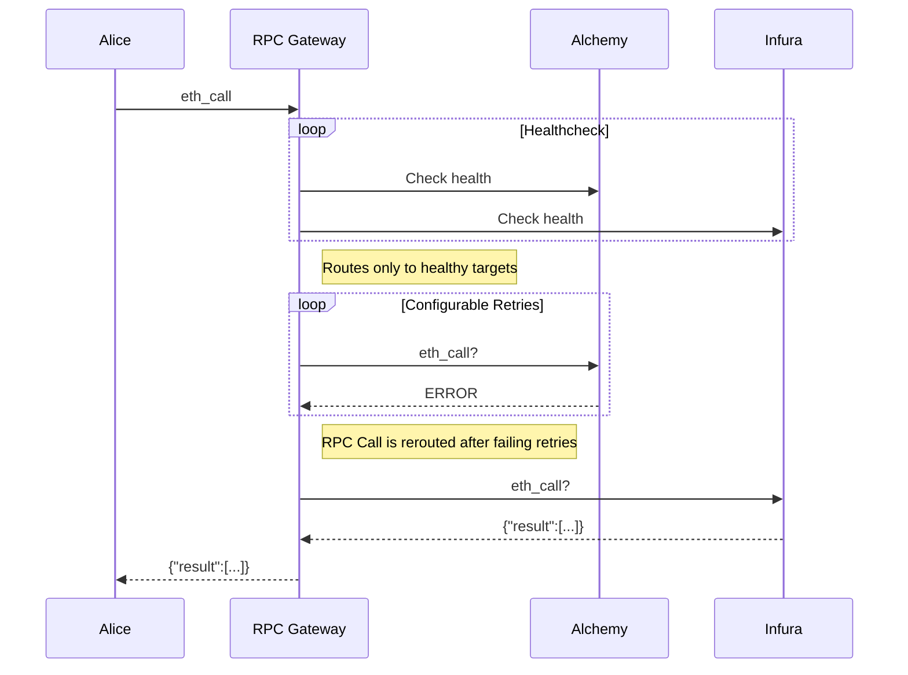

# RPC Gateway

A high-performance RPC gateway that provides load balancing and health checking for multiple RPC providers.

## Features

- Load balancing across multiple RPC providers
- Health checking with automatic failover
- Support for multiple chains
- Configurable timeouts and intervals
- Request bodies are limited to 16 MiB (larger requests get HTTP 413)
- Unknown config keys are rejected at startup

## Configuration

The gateway is configured using a YAML file. Here's an example configuration:

```yaml
port: 3000 # port for RPC gateway

proxies:
  - path: "eth" # directory path for the proxy (e.g. http://localhost:3000/eth)
    timeout: "1s" # health checks, and time for a provider to start responding or stall mid-response
    healthChecks:
      interval: "12s" # how often to do healthchecks
      blockDiffThreshold: 2 # how many blocks behind the max block number to taint
    targets:
      - name: "provider1"
        connection:
          http:
            url: "https://provider1.example.com"
      - name: "provider2"
        connection:
          http:
            url: "https://provider2.example.com"
```

### Configuration Parameters

- `port`: The port on which the RPC gateway will listen
- `proxies`: List of proxy configurations for different chains
  - `path`: The URL path for this proxy (e.g., "eth" for Ethereum)
  - `timeout`: Health check timeout, and how long a provider may take to start responding (send response headers). Response bodies may stream for as long as needed, but a provider that sends nothing for longer than `timeout` mid-response is cut off
  - `healthChecks`: Health check configuration
    - `interval`: How often to perform health checks
    - `blockDiffThreshold`: Maximum allowed block difference between providers
  - `targets`: List of RPC providers
    - `name`: Provider identifier
    - `connection.http.url`: Provider's HTTP URL

## Health Checking

The gateway performs health checks on each RPC provider:

1. Block number check: Verifies the provider can return the latest block number (on EVM, also its chain ID, requested once and again when a tainted provider is rechecked)
2. `eth_call` check: Verifies the provider executes EVM code (SHA-256 precompile), every second cycle

A provider is marked as unhealthy if:
- Any health check fails
- Its block number is more than `blockDiffThreshold` behind the highest block of the same check cycle (allowing for blocks produced while the other providers were still answering)

A provider marked unhealthy by health checks comes back only after a scheduled check passes once its backoff (30 s, doubling up to 20 min) has elapsed. Failed live requests taint for a short time (10–60 s) and rate-limited (HTTP 429) providers recover through a probe.

All EVM endpoints of a path must report the same chain ID. If they disagree (a misconfigured URL), the gateway logs an error listing each endpoint's chain ID and answers 503 for that path until the wrong URL is removed from the config.
- The provider fails to respond within the configured timeout

A provider is marked as healthy again as soon as it passes a health check.

## Building

```bash
go build -o rpc-gateway
```

## Running

```bash
./rpc-gateway -config config.yml
```

## License

MIT



## Development

Make sure the test pass
```console
go test -v ./...
```

To run the app locally
```console
# Set log level (optional, defaults to "warn")
export LOG_LEVEL=debug  # Available levels: debug, info, warn, error

go run . --config example_config.yml
```